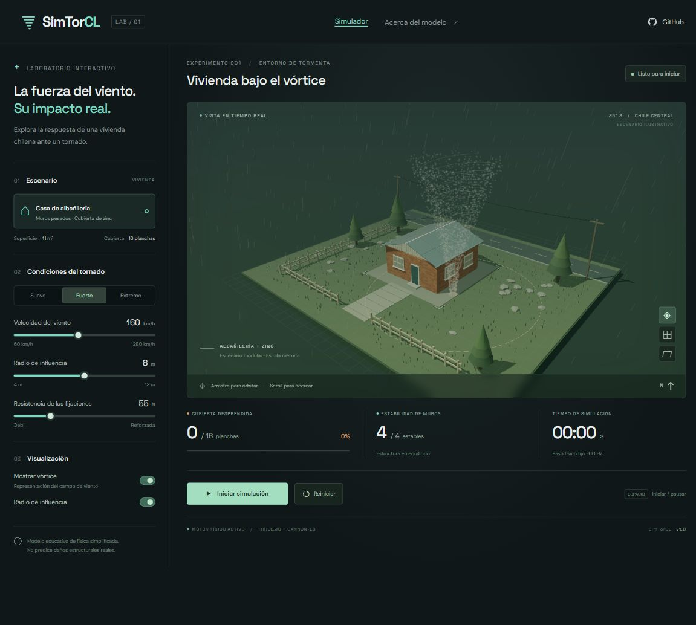
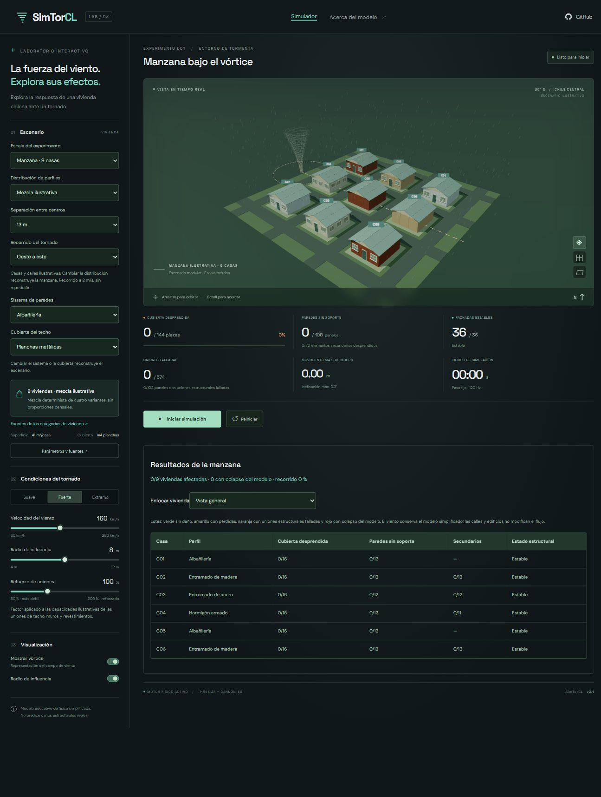
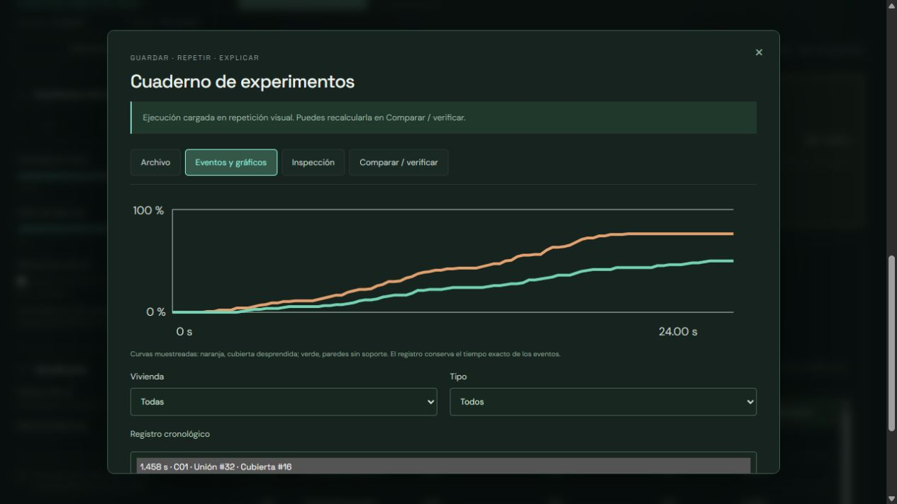
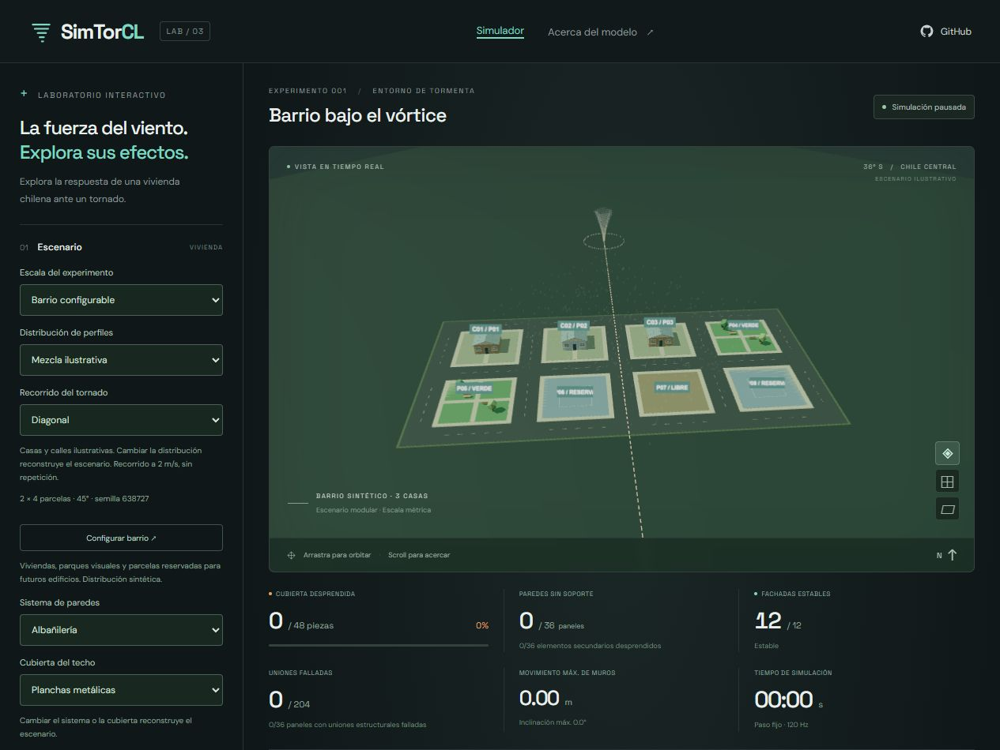
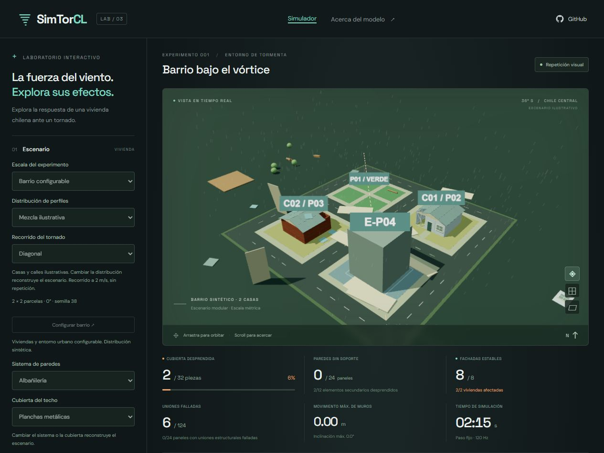

# SimTorCL

Laboratorio educativo 3D de viento, desprendimiento de cubiertas y daño en paredes de viviendas chilenas. La versión 2 incorpora un catálogo basado en categorías del **Censo 2024**, uniones que pueden fallar y comparaciones reproducibles.



Construido con Vite, Three.js y Cannon-es. Viviendas, texturas, vegetación y efectos se generan en código. Las tipografías se incluyen localmente; la aplicación compilada funciona sin Google Fonts ni servicios externos. Las licencias de bibliotecas y fuentes se distribuyen en `public/licenses/`.

## Ejecutar

Requiere Node.js 22.12 o superior (recomendado: Node 24) y un navegador moderno con WebGL 2.

```sh
git clone https://github.com/CitriCool/SimTorCL.git
cd SimTorCL
npm ci
npm run dev
```

Abre http://127.0.0.1:5173. Si el puerto está ocupado, usa `npm run dev -- --port 5174`.

```sh
npm test          # Catálogo, combinaciones, daños, colisiones y reproducibilidad
npm run build    # Sitio estático en dist/
npm run preview  # Revisión de la versión compilada
```

## Viviendas y cubiertas

| Perfil de simulación | Categoría censal de paredes     | Cubiertas disponibles                     |
| -------------------- | ------------------------------- | ----------------------------------------- |
| Albañilería          | Albañilería                     | Metal, fibrocemento, tejas/tejuelas, losa |
| Entramado de madera  | Tabique forrado por ambas caras | Metal, fibrocemento, tejas/tejuelas       |
| Entramado de acero   | Tabique forrado por ambas caras | Metal, fibrocemento, tejas/tejuelas       |
| Hormigón armado      | Hormigón armado                 | Metal, fibrocemento, tejas/tejuelas, losa |

Son tres familias con cuatro variantes ilustrativas y **14 combinaciones**. Madera y acero comparten categoría censal: no se les asignan frecuencias separadas. Las disponibilidades son decisiones del catálogo educativo, no restricciones extraídas del censo ni una certificación de factibilidad constructiva.

Las cubiertas inclinadas tienen 16 planchas de metal/fibrocemento o 64 módulos de tejas. La losa es un único cuerpo pesado y plano, con cuatro apoyos predefinidos. Cada vivienda tiene cuatro fachadas divididas en tres segmentos estructurales. Los entramados incluyen 12 revestimientos independientes y el hormigón, 11 módulos de ventanas secundarias.

## Controles

| Control                       | Función                                                                |
| ----------------------------- | ---------------------------------------------------------------------- |
| Sistema de paredes / cubierta | Reconstruir la casa con el perfil elegido                              |
| Parámetros y fuentes          | Consultar valores, unidades, supuestos y fuentes censales              |
| Velocidad / radio             | Ajustar viento de 0 a 280 km/h y campo de 4 a 12 m                     |
| Refuerzo de uniones           | Multiplicar las capacidades base entre 50 y 200 %                      |
| Iniciar / pausar o Espacio    | Controlar el tiempo                                                    |
| Reiniciar o R                 | Reconstruir piezas, uniones y estadísticas, conservando los parámetros |
| Vórtice / radio               | Cambiar ayudas gráficas, sin alterar la física                         |
| Arrastrar / rueda / vistas    | Orbitar, acercar y elegir perspectiva, planta o frente                 |
| Comparar perfiles             | Ejecutar 10, 20 o 30 segundos desde cero para cada perfil compatible   |

Los atajos no interfieren con formularios ni diálogos. Abrir un diálogo o cambiar de pestaña pausa el experimento interactivo. Los cambios de viento o refuerzo afectan las uniones aún intactas; reconstruir requiere reiniciar.

## Qué mide

- Cubierta desprendida y número de piezas según el material.
- Segmentos estructurales que perdieron conexión a la base.
- Revestimientos o ventanas secundarias desprendidos, por separado de la estructura.
- Uniones falladas y segmentos afectados por rotura de uniones estructurales.
- Fachadas estables, desplazamiento e inclinación máximos de paredes.
- Estado estructural simplificado, sin deducir colapso únicamente por perder el techo.

Una fachada es estable si sus tres segmentos siguen conectados a la base, se desplazan menos de 5 cm y se inclinan menos de 5°. Se muestra pérdida de soporte con dos o menos fachadas estables y colapso del modelo cuando al menos la mitad de los segmentos estructurales superan 45° de inclinación o descienden más de 0,8 m. Los máximos son observados durante toda la ejecución y se borran al reconstruir.

## Física y alcance

El motor usa un paso fijo de 1/120 s, gravedad de 9,82 m/s², un campo ilustrativo proporcional al cuadrado de la velocidad y arrastre que depende de la velocidad de los fragmentos. Las paredes reciben cargas según su orientación y superficie; se eliminó la reducción general utilizada en la versión inicial.

Las uniones son enlaces rígidos idealizados entre base, segmentos de pared, cubierta y elementos secundarios. Una sobrecarga sostenida de 0,12 s rompe un enlace. Los segmentos sin camino a la base pasan a ser cuerpos dinámicos; las uniones aún intactas entre segmentos liberados se mantienen como restricciones rígidas Cannon-es. Las piezas de cubierta y revestimiento también pueden liberarse al perder sus apoyos. La losa se libera al quedar menos de tres de sus cuatro apoyos idealizados.

**El censo aporta categorías; todas las masas, resistencias, geometrías y cargas son supuestos educativos.** No existe validación experimental ni cálculo continuo de tensiones, presión interior, deformaciones, armaduras o transferencia detallada de cargas entre elementos fijados. Las roturas de albañilería separan segmentos rígidos; los trazos de grietas son una representación esquemática de uniones falladas. Los vanos son visuales y los entramados usan colisionadores de caja, aunque su representación sea abierta. El piso y las fundaciones no se dañan. Una corrección de penetración protege el plano del suelo frente a fragmentos finos; no hay detección continua general de colisiones.

El tiempo por cuadro se limita a 0,1 s para evitar acumulaciones inestables: un equipo lento puede avanzar más despacio que el reloj. La comparación corre en un Web Worker, siempre desde viviendas intactas, con idénticos viento, radio, refuerzo, trayectoria, dimensiones y duración. El cuadro interactivo no altera el cálculo comparativo. Se puede cancelar sin modificar el escenario.

[Ver una captura del comparador](docs/comparacion.jpg).

La comparación describe estos supuestos, no una clasificación real de seguridad de materiales ni una predicción de daños de una vivienda real.

## Datos y documentación

- [Categorías, fuentes y calibración del modelo](docs/modelo.md).
- [Roadmap maestro: experimentos, edificios, zonas verdes y análisis avanzado](ROADMAP.md).
- [Lista de tareas y entregas anteriores](TODO.md).
- [INE: glosario de vivienda del Censo 2024](https://censo2024.ine.gob.cl/wp-content/uploads/2025/05/Glosario_viviendas_y_servicios-basicos_CPV2024.pdf).
- [INE: manual censal](https://censo2024.ine.gob.cl/wp-content/uploads/2025/03/Manual_Censal_CPV2024.pdf).
- [INE: resultados, tabulados y microdatos](https://censo2024.ine.gob.cl/resultados/).

No se cargan frecuencias nacionales, regionales ni de combinaciones de paredes y techo. La forma de la vivienda es ilustrativa: no reproduce una casa observada en el censo. Las categorías de materialidad aceptable/recuperable/irrecuperable tampoco se utilizan como resistencias al tornado.

## Estructura

```text
src/catalog.js             Categorías censales, perfiles y parámetros con procedencia
src/physics.js             Grafo de uniones, fuerzas, rotura, colisiones y métricas
src/environment.js         Modelos de árboles, bancos y edificios; procedencia y daño
src/urban.js               Geometría urbana, semilla y asignación de usos
src/urban-ui.js            Formulario e inventario de parcelas
src/scene.js               Modelos y efectos Three.js; reconstrucción y liberación de GPU
src/main.js                Selectores, diálogos y bucle de tiempo fijo
src/comparison.js          Ejecuciones reproducibles independientes de la escena
src/comparison.worker.js   Comparación en segundo plano y progreso
src/notebook.js            Biblioteca, eventos, inspección y repetición visual
src/records.js             Formato versionado, validación, CSV e informes HTML
src/library.js             Biblioteca local con IndexedDB
src/runs.js                Recálculo y comparaciones A/B de escenarios
src/runs.worker.js         Ejecuciones en segundo plano
src/style.css              Interfaz adaptable
index.html                 Interfaz en español
test/physics.test.js       Pruebas de comportamiento
.github/workflows/ci.yml    Pruebas, compilación y artefacto dist en GitHub Actions
```

## Distribución

`npm run build` produce `dist/`, con rutas relativas para servir desde una subcarpeta, incluido GitHub Pages. El repositorio ejecuta pruebas y compilación en GitHub Actions y guarda el sitio como artefacto; no activa despliegue automáticamente.

Los PDF originales de referencia, dependencias instaladas, archivos compilados, temporales y variables de entorno permanecen fuera del control de versiones.

Documentación de bibliotecas: [Three.js](https://threejs.org/docs/), [Cannon-es](https://pmndrs.github.io/cannon-es/docs/), [Vite](https://vite.dev/guide/).

## Manzanas ilustrativas (v2.1)



El selector de escala permite mantener la casa individual o generar 9 o 16 viviendas, con separación de centros de 10, 13 o 16 m. Se puede usar el mismo perfil en todas las casas o una mezcla determinista de cuatro variantes; esa mezcla no representa frecuencias del censo. La cubierta es común. La losa queda excluida de mezclas que incluyen entramados livianos. Las filas alternan orientación y cada casa tiene un identificador C01, C02, etc.

Las casas comparten un único mundo Cannon-es y un único plano físico. Los fragmentos pueden colisionar con otras viviendas, aunque el modelo de uniones aún no convierte esos impactos en roturas adicionales. El viento sigue siendo el campo simplificado, sin canalización ni apantallamiento entre edificios. Las calles, las parcelas y sus dimensiones son ilustrativas.

El tornado cruza en diagonal, de oeste a este o de sur a norte a 2 m/s; al terminar permanece en el extremo de salida. Reiniciar devuelve todas las viviendas y el tornado a sus estados iniciales. La tabla muestra los resultados de cada casa y los contadores superiores suman las piezas del conjunto. Los lotes cambian de color según daños secundarios, fallas de uniones estructurales y colapso del modelo. El selector de enfoque permite inspeccionar cada vivienda. El comparador independiente de perfiles queda disponible en modo individual.

Para mantener la interfaz utilizable, el modo manzana limita a cuatro pasos físicos por cuadro: en equipos lentos el tiempo simulado puede avanzar más despacio que el real. La geometría visual se simplifica en esta escala. No se garantiza una tasa de cuadros específica.

Las pruebas de manzana verifican el mundo compartido, ausencia de daño sin viento, sumas por vivienda, paso del tornado, reconstrucción, validación y una colisión real entre un fragmento y una vivienda vecina.

## Cuaderno de experimentos (v2.2)

El cuaderno permite guardar, cargar, duplicar y nombrar configuraciones y ejecuciones; importar/exportar JSON; consultar eventos y piezas; recorrer fotogramas; recalcular resultados y comparar escenarios A/B de casas o manzanas, cambiando una condición a la vez. Incluye CSV por vivienda, conjunto, pieza y evento, informes HTML con captura 3D y enlaces de configuración.

La biblioteca se conserva en el navegador y requiere exportación JSON para trasladarse a otro equipo. La repetición usa fotogramas muestreados y permite recuperar la ejecución pausada anterior. El recálculo reproduce los pasos y controles iniciales. Las importaciones requieren un modelo compatible y se limitan a 40 MB.

[Guía del cuaderno, formato, migración y límites](docs/experimentos.md). Las 62 pruebas cubren física, manzanas, persistencia del formato, eventos, exportación y reproducción.



## Generador de barrio (v2.3)

Selecciona **Barrio configurable** y abre **Configurar barrio**. Genera entre 4 y 16 parcelas con orientación, semilla, calles y veredas, ocupación residencial y proporciones de áreas verdes y reservas para edificios. El inventario identifica todas las parcelas y permite enfocarlas.

Las viviendas participan en la física; las reservas azules representan espacios para futuros edificios. Parques, árboles y bancos son visuales. El plano se guarda en JSON de esquema 2 y se exporta a CSV e informes. Los experimentos de v2.2 continúan cargando. El editor manual se abordará en la siguiente entrega.

[Guía del generador y sus límites](docs/barrio.md).



## Entorno físico (v2.4)

En Barrio configurable se pueden generar árboles y bancos con uniones rompibles y edificios de 2 a 5 pisos con estructura fija y envolvente desprendible. Comparten el mundo de colisiones con las viviendas y aparecen en inspección, eventos, resultados, CSV, fotogramas e informes. El formulario incluye una prueba reproducible de parque y edificio.

Las referencias oficiales se distinguen de las propiedades mecánicas educativas pendientes de calibración. El suelo permanece fijo, no se recalcula el viento por obstáculos y los contactos no añaden roturas al receptor. Los archivos antiguos conservan su modo visual al migrar al esquema 3.

[Alcance, fuentes, prueba y compatibilidad](docs/entorno-fisico.md).


