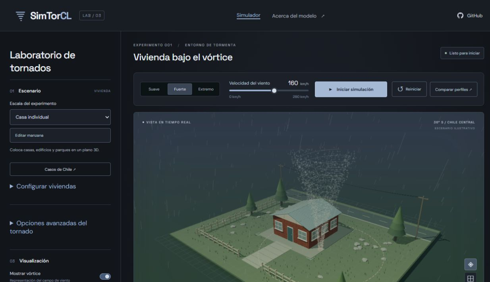
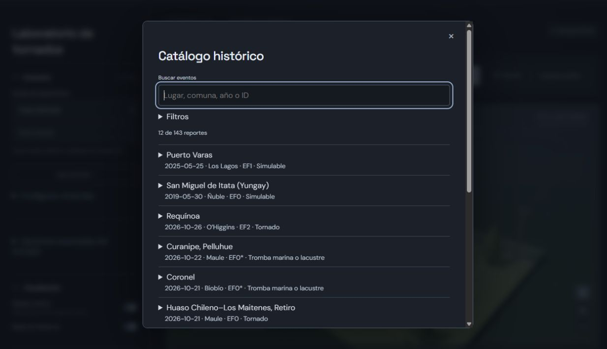
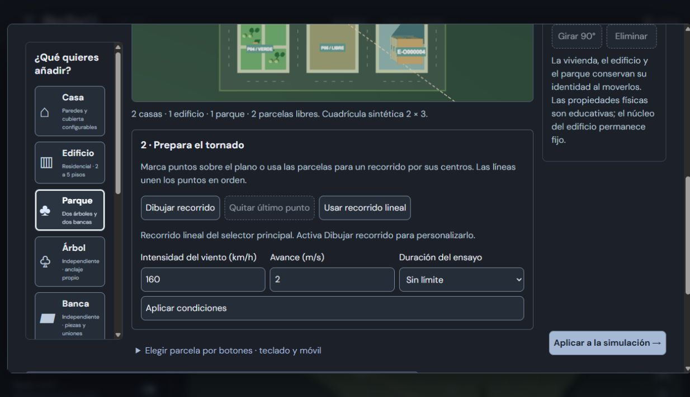

# SimTorCL

**Laboratorio educativo 3D de tornados y vientos extremos en Chile.** Explora cómo responde una vivienda a un escenario de viento, compara dos ensayos y consulta casos documentados en el país. SimTorCL está pensado para estudiantes, docentes y personas interesadas en entender el fenómeno mediante la experimentación.



## Una actividad para el aula

**Pregunta de partida:** ¿qué cambia en el modelo cuando reforzamos las uniones de la cubierta?

1. Abre **Casos de Chile**, elige **Puerto Varas** y consulta la ficha del evento, sus fuentes y los antecedentes del recorrido.
2. Pulsa **Abrir tramo urbano** y luego **Aplicar a la simulación**. Antes de iniciar, plantea una predicción sobre qué piezas podrían desprenderse.
3. Ejecuta el escenario. En **Entiende lo que ocurrió**, elige una vivienda o una pieza y revisa el evento registrado.
4. Usa **Comparar refuerzo A / B**. Mantén la misma vivienda, intensidad del viento, trayectoria y duración, y cambia solo el refuerzo. Compara la cantidad de piezas desprendidas y el orden de las fallas.
5. Discute qué se observó en el caso histórico, qué se obtuvo en la simulación y cómo influyen los supuestos en lo que se puede concluir.

La [guía del taller](docs/taller.md) incluye instrucciones para explorar el caso y preparar otros ensayos.

## Casos de Chile

El catálogo permite buscar reportes por lugar, comuna, año o identificador. Las fichas reúnen antecedentes y fuentes. Algunos casos, como Puerto Varas y San Miguel de Itata, incluyen acceso a un escenario educativo.



## Construye y compara tus escenarios

En **Editar manzana** puedes partir de un ejemplo, incorporar viviendas, edificios y áreas verdes, o dibujar un recorrido para el tornado. Usa el **Cuaderno de experimentos** para revisar eventos, guardar configuraciones y exportar resultados. Así puedes repetir una actividad con el mismo escenario o comparar el efecto de un único cambio.



## Cómo interpretar los resultados

La evidencia histórica proviene de las fuentes de cada caso. Los daños que aparecen durante el ensayo son resultados de un modelo simplificado. Las categorías de vivienda se inspiran en el **Censo 2024**, mientras que la geometría, las cargas y las resistencias usan supuestos educativos. La simulación permite comparar condiciones dentro del modelo. Las estimaciones de daños reales requieren datos constructivos y validación experimental.

- [Modelo físico, fuentes y calibración](docs/modelo.md)
- [Biblioteca de parámetros y procedencia](docs/parametros.md)
- [Cuaderno, comparación A/B y formatos de exportación](docs/experimentos.md)
- [Editor de manzanas y compatibilidad](docs/editor.md)
- [Glosario de vivienda del Censo 2024](https://censo2024.ine.gob.cl/wp-content/uploads/2025/05/Glosario_viviendas_y_servicios-basicos_CPV2024.pdf)

## Hacia dónde va el proyecto

La siguiente etapa propuesta es **pilotear una actividad con una comunidad escolar del sur de Chile**. El trabajo con docentes ayudaría a elegir las preguntas del taller, preparar una guía reutilizable y evaluar si el estudiantado distingue la evidencia histórica de los resultados simulados. A partir del piloto se podría ampliar el catálogo hacia un atlas educativo con más casos y contextos territoriales. Consulta el [plan de desarrollo técnico](ROADMAP.md).

## Ejecutar localmente

Requiere **Node.js 22.12 o superior** y un navegador con **WebGL 2**.

```sh
git clone https://github.com/CitriCool/SimTorCL.git
cd SimTorCL
npm ci
npm run dev
```

Abre [http://127.0.0.1:5173](http://127.0.0.1:5173). Si el puerto está ocupado, usa `npm run dev -- --port 5174`.

```sh
npm test
npm run build
npm run preview
```

El proyecto usa Vite, Three.js y Cannon-es. La compilación genera un sitio estático en `dist/`. El flujo de GitHub Actions ejecuta pruebas y conserva la compilación como artefacto. Las licencias de las dependencias y tipografías están en [public/licenses](public/licenses/).
