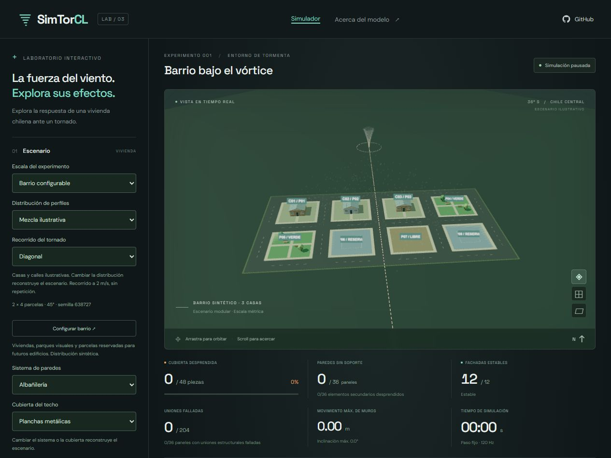

# Generador de barrio (base v2.3)

Actualización v2.4: el modo físico genera árboles, bancos y edificios; el modo visual conserva las reservas descritas aquí. Consulta [su alcance y fuentes](entorno-fisico.md).

Selecciona **Barrio configurable** en Escala del experimento y abre **Configurar barrio**. Esta es la primera entrega de generación urbana: construye el plano y asigna usos a las parcelas. El editor para modificar objetos individualmente y el catálogo de edificios siguen pendientes.

## Parámetros

| Parámetro               | Valores                                                                         |
| ----------------------- | ------------------------------------------------------------------------------- |
| Filas / columnas        | De 2 a 4 por lado: entre 4 y 16 parcelas                                        |
| Lado de parcela         | 12, 16 o 20 m                                                                   |
| Ancho de calle          | 4, 6 u 8 m                                                                      |
| Vereda                  | 1,2 m alrededor de cada parcela                                                 |
| Orientación             | De 0° a 315°, en pasos de 45°                                                   |
| Semilla                 | Entero entre 0 y 4294967295                                                     |
| Ocupación residencial   | Del 25 al 100 % de las parcelas que quedan después de asignar verdes y reservas |
| Parcelas verdes         | Del 0 al 50 % del total de parcelas                                             |
| Reservas para edificios | Del 0 al 50 % del total de parcelas                                             |

Verdes y reservas suman como máximo el 75 %. Cada cantidad se redondea hacia abajo; el número de viviendas se redondea hacia arriba al aplicar la ocupación residencial. Siempre queda al menos una casa. El resto son parcelas libres. Por eso las proporciones realizadas pueden diferir de las solicitadas en cuadrículas pequeñas. El formulario y el inventario muestran los recuentos efectivos.

La misma semilla y los mismos parámetros generan los mismos usos, perfiles, identificadores y posiciones. Cambiar refuerzo o viento conserva el plano. Cambiar orientación, lado de parcela o ancho de calle conserva los usos asignados a los mismos P, mientras cambia la geometría. Cambiar filas, columnas, proporciones o semilla puede reasignar usos.

La geometría es una cuadrícula rectangular sintética. Incluye calles perimetrales e interiores, veredas perimetrales, accesos simples y patios libres alrededor de las viviendas. No reproduce una manzana observada ni proporciones del censo. El perfil uniforme o la mezcla de variantes siguen siendo elecciones del catálogo educativo.

## Objetos e identificadores

- **P01, P02, etc.**: identificadores de parcela por fila y columna. El inventario muestra uso, superficie, centro en metros y vivienda asociada. Puedes enfocar cualquier parcela desde el selector.
- **C01, C02, etc.**: viviendas con piezas y uniones que participan en la física. Cada resultado incluye su parcela P. Al cambiar la ocupación, la numeración C puede cambiar; usa P para relacionar ubicaciones entre planos.
- **Reserva para edificio**: parcela azul con una huella esquemática de 8 × 8 m. No contiene un edificio, cuerpos de colisión ni un modelo resistente.
- **Área verde**: césped, senderos, árboles y bancos visuales. No colisionan, no sufren daño y no modifican el viento.
- **Parcela libre**: espacio disponible sin construcción.

La separación de centros es `lado de parcela + 2 × vereda + ancho de calle`. La envolvente de vivienda queda dentro de 7,4 × 7,4 m, con retiro mínimo de 2,3 m en las parcelas más pequeñas. La huella de reserva mantiene al menos 2 m de retiro. Las intersecciones entre calles y entre senderos son intencionadas. Las pruebas verifican que parcelas, envolventes, veredas y calzadas respeten estas separaciones para todas las dimensiones y orientaciones admitidas.

Las casas comparten el mismo mundo físico y reciben el campo de viento existente. La orientación se aplica a las posiciones y a los cuerpos de las viviendas, además de al terreno visual. El tornado recorre los límites del barrio a 2 m/s, en coordenadas globales: girar el barrio cambia su relación con el recorrido. Los escenarios más amplios requieren más tiempo para completar el cruce.

## Guardado y comparación

El cuaderno conserva el barrio en configuraciones y ejecuciones JSON de **esquema 2**. `initial` incluye todos los parámetros urbanos y `layout` registra la versión `urban-grid-v1`, parcelas, usos, centros, calles, límites, superficies y recuentos. Al importar se regenera el plano y se comprueba su coincidencia antes de sustituir el escenario.

Los archivos de esquema 1 creados en v2.2 siguen cargando mediante una migración al esquema 2, sin alterar la física de la casa individual ni de las manzanas fijas. Un caso de ejecución v2.2 está guardado como prueba de compatibilidad. También se conservan los enlaces de configuración antiguos. Las configuraciones v0 siguen admitidas con valores predeterminados para los parámetros omitidos.

**CSV de parcelas** exporta todas las parcelas, incluso las que no contienen vivienda. El CSV de viviendas incluye P, y el informe HTML incluye el inventario del plano. La repetición visual y el recálculo reconstruyen la misma distribución guardada.

La comparación A/B admite lado de parcela y orientación para este modo, además de refuerzo, distribución de perfiles, cubierta y trayectoria. La separación fija de 10/13/16 m corresponde a las manzanas anteriores; el barrio usa su propia regla de separación. Las duraciones cortas pueden cubrir solo una parte del cruce del tornado.

