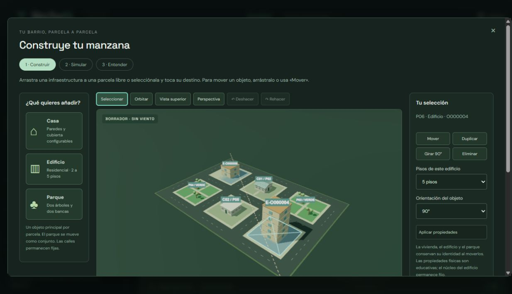

# Editor de manzanas (v2.6)

Abre **Construir mi manzana**. El editor pausa el experimento y crea un borrador independiente con su propia vista 3D. Cerrar el borrador no modifica los cuerpos, resultados ni configuración del experimento original.

## Construir y configurar

- Arrastra **Casa**, **Edificio** o **Parque** desde la paleta hasta una parcela libre. También puedes seleccionar una infraestructura y pulsar su destino en el plano o en los botones de parcelas.
- Selecciona una infraestructura para consultar sus propiedades. Arrástrala a una parcela libre o pulsa **Mover** y elige el destino. **Duplicar** conserva las propiedades y crea otra identidad.
- **Girar 90°** cambia la orientación del objeto. En el panel puedes elegir 0°, 90°, 180° o 270° respecto de la orientación general del barrio.
- Cada casa conserva su perfil y cubierta; las opciones se restringen a combinaciones compatibles. Cada edificio admite entre 2 y 5 pisos. El parque conserva dos árboles y dos bancas como conjunto.
- **Eliminar**, **Deshacer** y **Rehacer** actúan sobre el borrador. El historial conserva hasta 80 operaciones. Una acción inválida no modifica objetos, identidades ni historial.
- **Vista superior** encuadra el plano para colocar; **Perspectiva** permite revisar volúmenes. Para mover la cámara con arrastre, activa **Orbitar**; vuelve a **Seleccionar** para editar objetos.

El destino se señala visualmente y mediante texto. Una parcela ocupada, una calle o el exterior no admiten otro objeto. La infraestructura anterior se conserva. Esta entrega ajusta cada objeto al centro de su parcela y permite una infraestructura principal por parcela; no ofrece desplazamientos libres dentro del lote ni calles editables.

En **Elegir parcela por botones · teclado y móvil**, las flechas recorren destinos y Enter selecciona o coloca. En pantalla táctil basta elegir un elemento y tocar su parcela. El arrastre no es obligatorio. Escape cancela una herramienta activa; otro Escape cierra el borrador. Ctrl/Cmd+Z deshace y Ctrl/Cmd+Shift+Z rehace fuera de los campos de texto.

## Guardar y usar la manzana

**Guardar diseño en biblioteca** conserva una configuración en IndexedDB, en el mismo origen del sitio. **Descargar diseño JSON** permite trasladarla. Se cargan desde el cuaderno de experimentos; también pueden compartirse con el generador de enlaces existente.

**Usar esta manzana** reconstruye el experimento intacto con el diseño elegido. Si hay pasos calculados, ofrece guardar la ejecución anterior antes de aplicar, aplicar sin conservar sus resultados o seguir editando. Si el guardado falla, el experimento anterior se conserva. Al terminar, ajusta el viento, inicia la simulación y consulta eventos, inspección y resultados en el cuaderno.

Durante una repetición visual el acceso al editor está deshabilitado. Se puede volver a la ejecución propia y abrir un nuevo borrador. No se continúa la física desde una geometría dañada editada.

Se admiten diseños vacíos o sin viviendas: los indicadores de viviendas quedan en cero y muestran **Sin viviendas**. Árboles, bancos y edificios conservan sus resultados separados. Un diseño sin casas no representa una casa estable ni un edificio validado estructuralmente.

Para cambiar filas, columnas, tamaño de parcela o ancho de calle, utiliza **Configurar barrio** y genera otro plano. Esa acción sustituye el plano manual; guarda antes el diseño y los resultados que quieras conservar. La edición inicial utiliza la cuadrícula existente, de 2 a 4 filas y columnas. Al abrir desde otro modo se propone una cuadrícula de 2 × 3 con parcelas libres.

Ejemplo importable: [manzana con dos casas, dos edificios y dos parques](examples/manzana-editor-v2.6.json).

## Formato y reproducibilidad

El esquema 5 incorpora `initial.sitePlan`, con versión `parcel-editor-1`, dimensiones de cuadrícula, secuencia de identidades y objetos por parcela. Cada objeto registra `id`, `parcelId`, `type`, `rotation` y las propiedades de su tipo (`profile`/`roof` o `floors`). El plano se almacena explícitamente: la semilla describe la generación de origen, pero no reconstruye las modificaciones manuales por sí sola.

La geometría resultante usa `urban-editor-v1`. Se rechazan identidades o parcelas duplicadas, destinos fuera del plano, combinaciones incompatibles, pisos u orientaciones inválidos y cuadrículas distintas. Las posiciones, dimensiones y geometrías de colisión se generan a partir de datos admitidos, sin aceptar coordenadas arbitrarias dentro del objeto.

Los identificadores `O000001`, etc., se conservan al mover y configurar objetos. Los identificadores de árboles, bancos y edificios incorporan esa identidad y registran su parcela actual. Las etiquetas C01, C02, etc., identifican las viviendas dentro de una ejecución y pueden renumerarse tras editar la distribución; los identificadores de objeto permanecen. Los CSV de viviendas, piezas, eventos y parcelas permiten conservar esa relación.

Cada casa utiliza su perfil y cubierta en la física y al importar fotogramas. Los edificios usan sus pisos y orientación propios; un parque gira y se traslada como conjunto. La comparación A/B conserva el plano manual cuando cambia el refuerzo. Los controles globales de perfil, cubierta y distribución no sustituyen las propiedades manuales: se editan por objeto. Las comparaciones de cubierta/distribución globales y tamaño de parcela se bloquean para estos planos, con una explicación.

El modelo de viviendas mantiene `pressure-v2.1` y `simtorcl-33082313`. El entorno manual declara `urban-environment-editor-1` y `parcel-quarter-turn-v1`, que amplían la geometría conservando las capacidades educativas. Los escenarios generados mantienen `urban-environment-1`. Los archivos de esquemas 1–4 migran con `sitePlan: null`, preservando su plano, modelo, biblioteca de procedencia disponible y resultados. Los enlaces de esas versiones siguen admitidos.

## Comprobaciones y límites

La suite contiene 78 pruebas: diez nuevas comprueban edición e historial, aislamiento del experimento, identidades, geometría y propiedades, escenarios sin viviendas, rechazo atómico, grabación con daño y recálculo exacto, enlaces de 16 objetos, comparación y migración de v2.5. Continúan pasando los casos históricos y las comprobaciones físicas anteriores.

En navegador se comprobaron arrastre desde la paleta, movimiento directo, rechazo de destinos ocupados, propiedades por casa/edificio, duplicación, deshacer/rehacer, teclado, guardado/exportación y carga, respaldo de una ejecución, repetición y reapertura del editor. Se revisó la alternativa de colocación por botones a 390 × 844, sin desbordamiento horizontal de la página ni del diálogo.

El editor no amplía la evidencia mecánica: siguen pendientes calibración técnica, colapso estructural de edificios, rotura adicional por impacto, suelo deformable y viento modificado por obstáculos. Árboles y bancos independientes, recorridos dibujados, ayudas guiadas y comparación visual ampliada se incorporan en [B3, v2.7](taller.md). La descripción de esquema 5 anterior documenta v2.6: los nuevos borradores utilizan esquema 6 y `parcel-editor-2`; los archivos históricos conservan su versión física al importarse. Calles y parcelas libres corresponden a B4.

## Compatibilidad de v2.7

Los nuevos borradores usan `urban-editor-v2` y `urban-environment-workshop-1`, con geometría `independent-nine-slots-v1`. `sitePlan.items` contiene árboles/bancas independientes y sus puntos, giros y anclajes. Abrir un diseño antiguo crea un borrador nuevo de esta versión; cerrar sin aplicar conserva la ejecución histórica.

El esquema 6 importa esquemas anteriores con `route: null`, `travelSpeed: 2`, `duration: null`, `lesson: null` y `scenarioModel: null`. No convierte los planos antiguos `parcel-editor-1` a la nueva física durante importación, repetición o recálculo. Una ejecución v2.6 con daño forma parte de las pruebas de regresión y reproduce exactamente sus métricas, eventos y poses.
