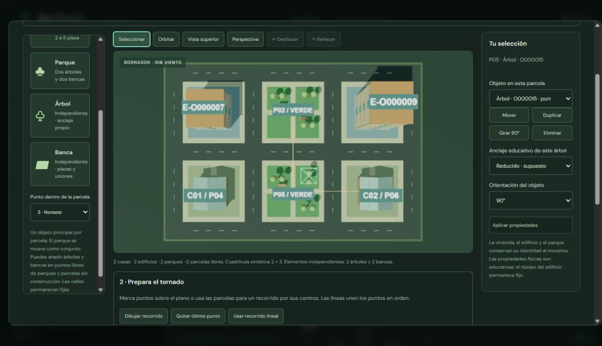

# Taller: construir, simular y entender — v2.7

B3 amplía el editor de parcelas de v2.6. Los cuatro ejemplos originales son distribuciones sintéticas modificables. Las categorías oficiales orientan el catálogo. Las capacidades mecánicas siguen siendo supuestos educativos.

## Preparar un ejemplo

1. Abre **Construir mi manzana → Aprender con un ejemplo**. Elige Residencial, Barrio mixto, Plaza con edificios o Viviendas reforzadas y carga el borrador. Puedes deshacer la carga.
2. Añade o modifica construcciones. Para árboles y bancas independientes, elige un punto libre del parque o de una parcela sin construcción. Hay nueve puntos por parcela y un máximo de 48 elementos independientes por diseño. Se rechazan solapamientos entre elementos y con los componentes originales del parque; no se permite colocarlos dentro de casas o edificios.
3. Selecciona un objeto en 3D o mediante **Objeto en esta parcela**. Puedes moverlo, girarlo, duplicarlo, eliminarlo y modificar las propiedades disponibles. El árbol permite anclaje estándar o reducido, ambos educativos. La identidad se conserva al moverlo; duplicar crea otra. Los elementos añadidos permanecen en su parcela al mover o eliminar el conjunto del parque.
4. En **Prepara el tornado**, usa **Dibujar recorrido** y marca los puntos en el plano, o utiliza los botones de parcelas para unir sus centros. Admite 2–24 puntos con al menos 0,5 m entre puntos consecutivos. Un solo punto puede quedar en borrador, pero no se guarda ni aplica. **Quitar último punto**, **Usar recorrido lineal** y Deshacer permiten corregirlo.
5. Ajusta intensidad (0–280 km/h), avance (0,5–8 m/s) y duración, y pulsa **Aplicar condiciones**. El formato admite duraciones enteras de 5–180 s o sin límite; el selector ofrece las más habituales y conserva otras duraciones importadas.
6. Guarda el diseño en biblioteca o JSON y pulsa **Usar esta manzana**. Si hay resultados anteriores, puedes conservarlos antes de reconstruir. El borrador no modifica la ejecución original hasta aplicarlo.

Ejemplo descargable: [Plaza con edificios](examples/plaza-v2.7.json), importable desde el cuaderno.

## Caso histórico de Puerto Varas 2025

Abre **Caso histórico · Puerto Varas 2025** en la pantalla principal, o selecciona el caso en **Aprender con un ejemplo**. El recorrido aparece en el borrador. Pulsa **Usar esta manzana** y luego **Iniciar simulación**. Puedes volver a ver la geometría intacta desde **Entiende lo que ocurrió** y consultar los daños calculados en el cuaderno.

- **Evento documentado.** El 25 de mayo de 2025, un tornado de categoría EF1 según la DMC afectó a Puerto Varas. La inspección documentó pérdidas de techumbre y permitió trazar su recorrido a partir de daños. El informe preliminar indica un avance general de noroeste a sureste. El municipio documenta afectación en Walker Martínez. [Mapa de la DMC](https://blog.meteochile.gob.cl/2025/06/18/encontrando-el-rastro-del-tornado-en-puerto-varas/) · [Dirección del recorrido](https://blog.meteochile.gob.cl/2025/05/26/siguiendo-las-huellas-de-un-destructivo-tornado-en-puerto-varas/) · [Municipalidad](https://www.ptovaras.cl/noticias/puerto-varas-conmemora-el-primer-aniversario-del-tornado-con-foco-en-reconstruccion-resiliencia-y-preparacion-climatica)
- **Escenario simulado.** Una cuadrícula sintética de 4 × 4 parcelas representa un tramo urbano inspirado en Walker Martínez. Incluye seis casas, dos edificios bajos, dos parques y un árbol independiente. La polilínea conserva la dirección general publicada y usa coordenadas locales aproximadas. Los materiales, calles y posiciones se asignaron con fines educativos.
- **Parámetros del ensayo.** 175 km/h de intensidad de referencia dentro del intervalo estimado por la DMC, 6 m/s de avance, 12 m de radio de influencia, 50 % de refuerzo y 25 s de duración. El refuerzo ilustra un caso de uniones vulnerables. El modelo calcula los desprendimientos y las fallas durante el ensayo. El radio y la velocidad de avance se ajustan al tramo local. La configuración, el recorrido y los resultados se conservan en el cuaderno.

**Puerto Varas 2025 · Corredor ampliado** prepara otro ensayo de 60 s, con aproximadamente 273 × 183 m, 12 viviendas, 3 edificios y 3 parques. Las 96 parcelas permiten editar la distribución. El trazado local conserva la dirección general del evento y el radio de influencia del ensayo original. Las calles y las construcciones siguen siendo ilustrativas.

## Ejecutar e interpretar

El avance se mide por longitud recorrida, también en los giros de la polilínea. Al llegar al último punto el tornado permanece allí; la física continúa hasta la duración declarada o hasta que se pause. Al cumplir la duración se detiene exactamente el cálculo. **Repetir ensayo** reconstruye el escenario desde cero. Llegar al final del recorrido no significa que haya cesado el viento.

El recorrido dibujado sustituye el selector lineal principal. Elegir una trayectoria lineal elimina la polilínea activa; guarda el diseño antes si deseas conservarla. Regenerar la cuadrícula elimina el plano manual y su recorrido. El modo de casa individual conserva su órbita y no utiliza la velocidad de traslación urbana.

En **Entiende lo que ocurrió**, selecciona un objeto en el listado o haz clic en una pieza visible. Un clic selecciona; arrastrar mueve la cámara. El panel muestra eventos de esa selección y explica:

- **Sobrecarga:** tiempo, demanda, capacidad asumida y unidad registrada (N o N·m).
- **Pérdida de soporte:** liberación de una pieza y eventos anteriores relacionados del grafo de apoyos.
- **Sin eventos:** ausencia de fallas registradas; esto no valida una construcción real.

**Ver en línea de tiempo** abre el evento del cuaderno. **Ver evento en 3D** muestra un fotograma muestreado igual o posterior al paso del evento, con la física detenida. Las explicaciones de la repetición solo incluyen eventos hasta el fotograma mostrado. **Volver a mi ejecución** recupera el estado físico previo.

**Ver geometría inicial** muestra posiciones y orientaciones intactas como referencia visual. No reinicia cuerpos, resultados ni eventos: los contadores siguen describiendo el estado calculado. **Ver estado calculado** restaura la representación del cálculo.

**Comparar refuerzo A/B** abre dos ensayos desde cero con barras de cubierta desprendida y tablas por vivienda y objeto urbano. Al variar refuerzo se mantienen plano, identidades, recorrido y condiciones restantes. La duración efectiva no supera la duración del escenario, aunque el comparador solicite más tiempo; se muestra el tiempo realmente calculado. El comparador de trayectorias permite contrastar la polilínea activa con un recorrido lineal. Comparar dos polilíneas arbitrarias desde ese formulario sigue pendiente.

## Formato, comprobaciones y límites

El esquema 6 conserva `sitePlan.items`, recorrido, avance, duración, ejemplo y descriptor `scenario-controls-1`. Los nuevos planos usan `parcel-editor-2`, geometría `urban-editor-v2` y entorno `urban-environment-workshop-1`. Cada árbol y banca independiente genera las mismas clases de piezas y uniones educativas del entorno anterior, con identidad propia. Los parques originales conservan su conjunto. Los archivos antiguos se importan sin cambiar retrospectivamente su modelo físico.

Las 88 pruebas incluyen daño y recálculo de elementos independientes, validación geométrica, historial, giros y velocidad del recorrido, detención exacta, cuatro ejemplos, unidades/causas, enlaces y comparación con geometría conservada. Una ejecución v2.6 dañada conserva exactamente sus eventos, poses y resultados. La compilación y el flujo de ejemplo modificado, ejecución, explicación, repetición y comparación se revisan en navegador.

Siguen pendientes la calibración física, colapso resistente de edificios, suelo deformable, ráfagas, perfil vertical y viento modificado por obstáculos. Desde v2.8 se pueden activar [roturas por impacto](experimentos.md#roturas-por-impacto-v28-y-esquema-7) en las condiciones del tornado. Calles y parcelas libres, otras especies, mobiliario y capas de inspección adicionales permanecen en el [roadmap](../ROADMAP.md).
